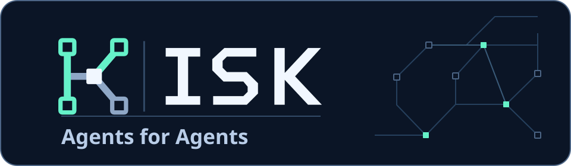
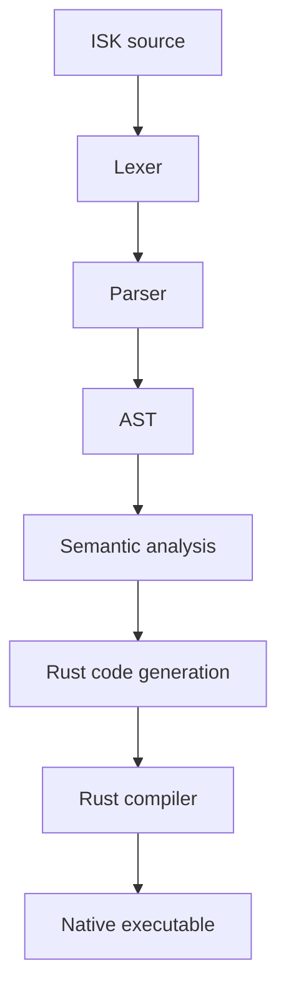
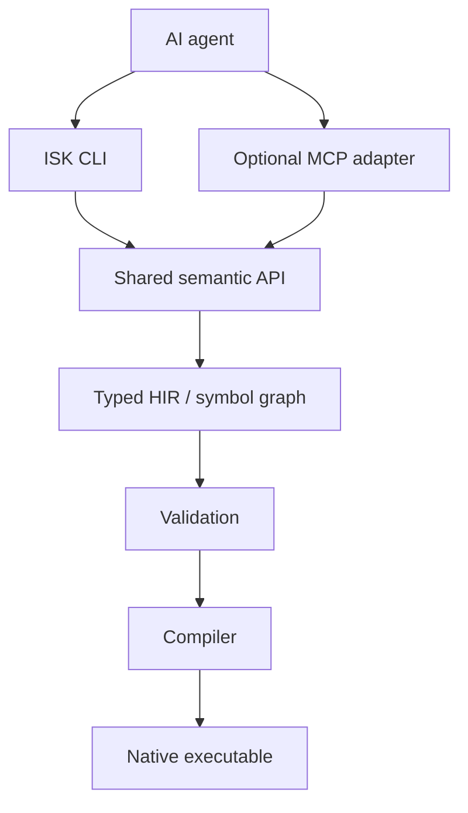
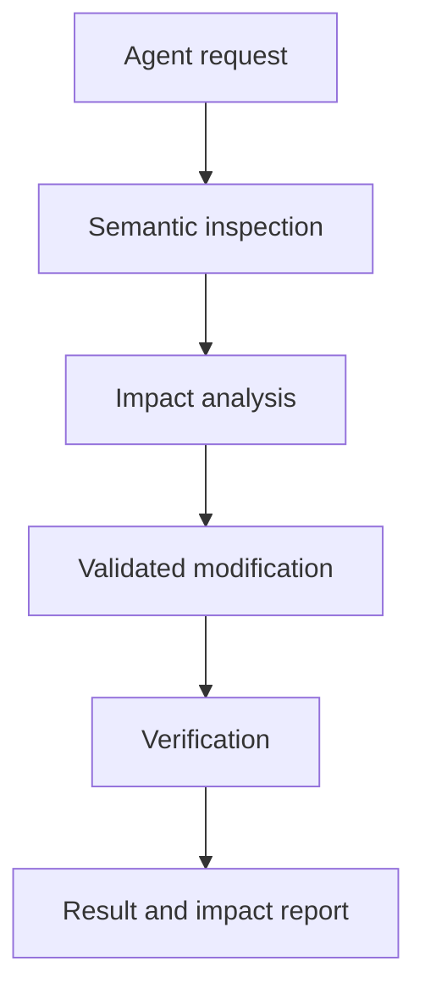

# ISK — Agents for Agents



**An experimental, semantic-first programming language for autonomous coding agents.**

[Quick start](#quick-start) · [Vision](docs/vision.md) · [Capability matrix](docs/capabilities.md) · [Architecture](#compiler-architecture) · [Roadmap](ROADMAP.md) · [Benchmarks](benchmarks/README.md)

## The idea

**Build a programming language for agents, not merely with agents.** ISK is
designed around how agents understand, change, and verify software. Source code
is one human-readable view of a program. Rather than infer meaning from text
alone, agents should be able to ask the compiler what a symbol means, where it
is used, and whether a proposed change is valid.

- **Semantics first.** Resolve symbols and references once so inspection and
  editing use the same facts as the compiler.
- **Verified changes.** Prefer edits the compiler can check before they touch
  the original source.
- **Measure the whole task.** Optimize the effort needed to deliver correct,
  maintainable software, without sacrificing safety, determinism, or native
  performance.

**Status: experimental bootstrap.** ISK has a working single-file compiler,
function inspection, and validated rename previews. The current syntax is
provisional. Rust is the bootstrap backend, not the language blueprint.

## Quick start

With stable Rust installed, run these commands from the repository root:

```sh
cargo run -- check examples/factorial.isk
cargo run -- run examples/factorial.isk
```

[The example](examples/factorial.isk) prints `3628800`:

```text
fn factorial(n: u64) -> u64 {
    if n <= 1 {
        1
    } else {
        n * factorial(n - 1)
    }
}

fn main() {
    print(factorial(10))
}
```

[The coprimality example](examples/coprime.isk) uses integer division and
recursion to compute a GCD, then prints `true`:

```sh
cargo run -- run examples/coprime.isk
```

To query the function or preview a rename without modifying the file:

```sh
cargo run -- inspect examples/factorial.isk factorial
cargo run -- inspect examples/factorial.isk factorial --json
cargo run -- rename examples/factorial.isk factorial fact
```

See the [CLI reference](docs/cli.md) for output formats, build artifacts, and
the supported language subset.

To create a runnable starter, use `cargo run -- new my-application`. Run its
starter with `cargo run -- check my-application` and `cargo run -- run my-application`.
See the [project model](docs/projects.md) for the current layout and proposed
manifest and workspace support.

## Compiler architecture

**Today.** The compiler parses and checks one source file. `check` does not
invoke `rustc`; `build` and `run` use it to produce a native executable.



**Proposed.** A typed program representation would let agents work through
the same semantic API, regardless of client. Validation remains part of the
compiler, not a rule each agent tool must reimplement.



## Agent-native workflow

**Target workflow.** The bootstrap already supports inspecting a function,
previewing a validated rename, and checking and running the result. Broader
dependency analysis and discovery of test entry points are planned.

The experimental [test selector](docs/cli.md#suggest-affected-tests-experimental)
can suggest named test roots for a known single-file body edit. It is advisory;
ordinary CI still runs the full regression suite.



The [engineering architecture](docs/architecture.md) explains the boundary
between the working compiler and the proposed semantic model.

## Roadmap and evidence

ISK separates three kinds of work:

- [Examples](examples/README.md) are small, runnable demonstrations of current language features.
- [Benchmarks](benchmarks/README.md) measure agent development effort under controlled conditions.
- [Showcase](showcase/README.md) contains growing reference applications that expose real maintenance needs. The first is a deterministic controller model; networking and services are future stages.

The [roadmap](ROADMAP.md) takes ISK from a stable bootstrap and reproducible
numerical pilot to a complete semantic editing workflow evaluated against
plain-text editing.

The [benchmark protocol](benchmarks/README.md) separates program measurements
from agent outcomes such as correctness, time, context, and correction effort.
The current GCD and coprimality pilot has reference runs for ISK, Rust, and
Python. It does not yet establish an agent-productivity advantage.

The [20-session controller pilot](benchmarks/results/2026-11-22-controller/README.md)
held the language fixed. All first submissions passed. Median total tokens
were about 23% lower for semantic rename and 4% higher for interlock repair;
the repair sessions did not use the extra tools. The text arm lacked grep.
This is preliminary tooling evidence, not a language or safety comparison.

## Contributing to ISK

Compiler and language-design work, research, benchmarks, documentation, and
reproducible bug reports are equally welcome. Human-written and AI-assisted
contributions are both welcome. Start with the [contributing guide](CONTRIBUTING.md)
or look for the `good first issue` label in Issues. Discuss major design changes
openly before implementation; see the [design evaluation](docs/research/design-evaluation.md)
for open questions.
CI runs on pushes to `main` and on pull requests. Reproduce it locally with
stable Rust (including `rustfmt` and `clippy`) and Python 3 for the existing
benchmark smoke check:

```sh
cargo fmt --check
cargo clippy --locked --workspace --all-targets -- -D warnings
cargo build --locked --bin isk
cargo test --locked --workspace
python3 benchmarks/pilot.py --task all --trials 1
```

For just the language checks, run `cargo test --locked --test e2e`. The suite
uses the built `isk` CLI to compile and execute the language examples and
controller showcase and checks their stdout and exit status. It also
distinguishes rejected source (exit `1`) from
well-typed programs that fail at runtime (exit `101` with the current backend).

Use `--trials 3` for repeated reference measurements. The
[wordmark](assets/isk-logo.svg) and [square icon](assets/isk-icon.svg) are also
available as standalone SVGs.

## License

ISK is available under the [MIT License](LICENSE). You can use, modify, and
redistribute it, including commercially, subject to the license notice
requirements.
