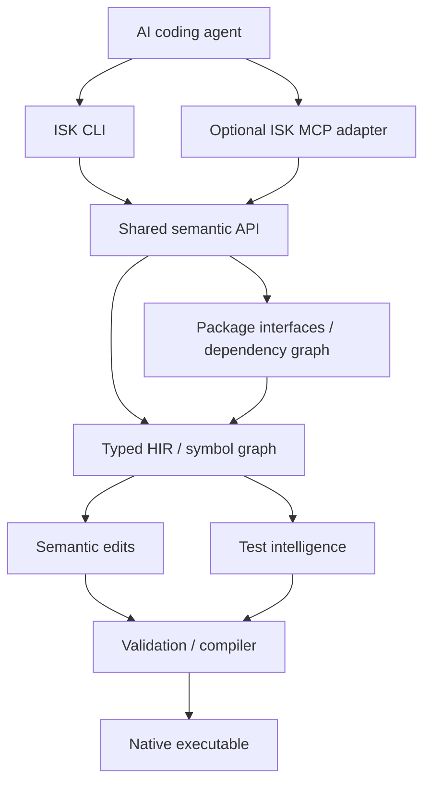

# ISK engineering architecture

If programming languages were invented primarily for agents, text would not
have to be their only interface. ISK treats human-readable source as one
representation of a program and checked semantics as the basis for understanding,
editing, and verifying it. The [project vision](vision.md) defines the mission;
these eight engineering pillars evolve together:

1. Agent-native language design.
2. Semantic-first program representation.
3. A shared, protocol-independent semantic API.
4. Agent-oriented CLI and optional MCP interfaces.
5. Efficient compilation, testing, and verification.
6. Empirical agent-efficiency evaluation.
7. Native performance, safety, and correctness.
8. Agent-native libraries, package intelligence, and supply-chain security.

Agent-native verification is a permanent requirement across these pillars.
Optimize the complete loop: understand, modify, validate, test, diagnose,
correct, and verify. Lower local test latency must not weaken regression coverage.

## What the bootstrap proves and where it stops

Rust is used to implement and bootstrap ISK, not to define its syntax or
semantics. The current pipeline lexes and parses source, checks signatures and
expressions, then emits Rust. The checker already records typed function
signatures, source-order function IDs, and resolved call locations. Those IDs
are deterministic for the same declaration order, not durable across
structural edits. `rename` uses the checked information, preserves untouched
source, and revalidates the candidate before printing it.

`CheckedProgram` reuses one parsed and checked source snapshot for read-only
queries and validated rename previews. `inspect --callers` exposes one
signature and resolved call sites with their enclosing functions, not
function bodies. This proves the API boundary,
not the final representation: expressions still lower from the AST, IDs and
byte spans are snapshot-local, and there is no module graph, incremental
checking, or coverage data yet. A rename plan stores a checked
candidate and exact original source. The CLI uses a SHA-256 fingerprint to
reject stale snapshots between invocations and stages an atomic replacement
next to the target. The final read and replacement are not a filesystem
compare-and-swap; concurrent writers are outside the prototype's contract.

`CheckedProgram::validate` returns a typed diagnostic or a reusable snapshot.
The library owns resolution, call ranges, change validation, and test
selection. The CLI owns filesystem access, exit status, and text, TSV, and
[JSON rendering](cli.md#json-output). Source diagnostics report a point,
not a source range or suggested action. Code generation consumes checked
programs but is not needed for queries or rename previews.

## Target architecture

### Minimal MCP adapter design

Start with an optional local stdio adapter exposing only `isk_inspect`.
Accept a source string and a function name, call `CheckedProgram::validate`
and `inspect_function`/`call_sites`, and return the same versioned data and
diagnostic codes as CLI JSON. Keep protocol errors separate from source and
lookup errors. This first tool does not read paths, write files, or build
programs. Before adding a second adapter, share the result mapping in a
transport-neutral adapter layer; keep serialization out of the semantic core.
Add parity tests before exposing more operations. Future edits must reuse
validated plans and snapshot guards, not implement their own write semantics.
A persistent workspace service and MCP server are not implemented.

### Libraries and dependency intelligence

Package identity, visibility, and dependency edges belong to the semantic
model, not the backend or a separate agent tool. Start with checked local
interfaces and explicit dependencies. The [package architecture](packages.md)
defines prerequisites, metadata evidence, and supply-chain trust boundaries.

### Applications and workspaces

The [project model](projects.md) separates filesystem and manifest loading
from compiler-derived semantics. Applications should expose a compact
project summary and targeted queries over the same shared API as single-file
operations. The current scaffold is a directory convention, not a manifest
loader or workspace resolver.

## Incremental evolution

1. Build on direct caller relationships and extend structured diagnostics.
   Keep identity separate from source spans; specify how IDs survive rename,
   insertion, and reordering before exposing cross-snapshot identities.
2. Build on the static single-file test-selection prototype. Compare checked
   snapshots to identify changed symbols, then associate test IDs with
   module, function, and contract entry points. Narrow only when the change
   and test inventory are known; retain the full suite as fallback.
3. Introduce typed HIR when a query or verification task needs it. Keep AST
   and human-readable source projections separate from resolved semantic facts.
   Extend those facts with types, module dependencies, control/data flow,
   contracts, effects, error propagation, ownership and lifetimes, invariants,
   and concurrency as experiments justify them. Add incremental verification
   with full-check equivalence tests before relying on cached results.

CLI and any later MCP adapter consume the same semantic API. Native code
generation is a consumer of language semantics, not their definition. Keep
the Rust backend while it supports experiments; evaluate alternative lowering
only when the language or performance needs it.

## Verification stages

1. **Now:** `affected-tests` walks reverse call edges from one supplied
   changed function to explicitly declared test roots. It returns focused
   suggestions or a machine-readable reason to run the full suite. It
   does not infer the change, discover tests, execute them, or prove coverage.
2. **Next:** Pilot deterministic execution of named tests and typed failure
   records with test ID, failure kind, expected and actual values where
   available, source span, and relevant symbols. Test whether focused reruns
   and failure explanations reduce repair time and context. Keep contracts
   and invariants in scope without committing to test syntax.
3. **Later:** Evaluate coverage-informed selection, boundary generation,
   property tests, and failure minimization against seeded defects and full
   regression results. Cache only when source, dependency, test, toolchain,
   and configuration inputs are tracked; invalidate on uncertainty.

No selected test set guarantees correctness. Invalid or uncertain analysis
must not be used to skip verification, and CI always runs the full regression
suite independently of the selector.

## Decision and release gates

For each significant change, record the agent-efficiency hypothesis, the prior
ISK version or relevant alternative, and a measurable success criterion before
evaluation. Record correctness, maintainability, safety, native performance,
and determinism constraints separately. After the smallest useful
implementation, record measurements, variability, limitations, and the
decision to keep, revise, or reject it. Use the
[ADR template](adr/template.md) and the [evaluation protocol](../benchmarks/README.md).
Run correctness and short reference checks continuously; reserve expensive
controlled agent trials for milestones. Do not ratify a language design on
implementation convenience or unmeasured benefits.

For a new language mechanism, compare it with the simplest existing
abstraction and with a tooling-only alternative. Specify which guarantee the
compiler can enforce, what complexity or runtime cost it adds, and what
result would justify keeping or rejecting it. If comparable tooling gives
the same benefit without changing semantics, prefer tooling unless the
language design has another demonstrated advantage. This gate does not
require a research ADR for a routine fix.
